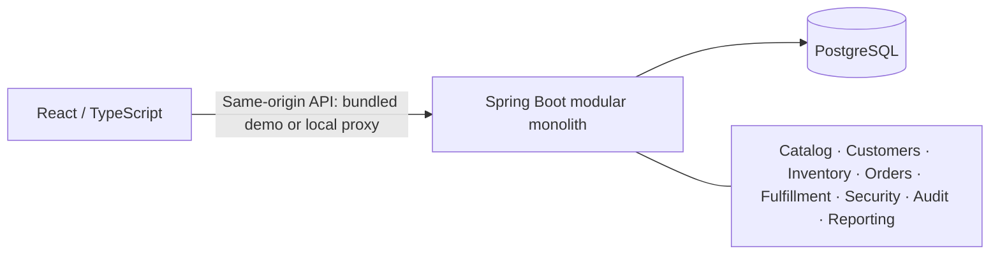

# OperationsFlow — B2B Order, Inventory & Warehouse Management Platform

[](https://github.com/CerenGzn/operationsflow/actions/workflows/ci.yml?query=branch%3Amain)

## Overview

OperationsFlow is a full-stack portfolio project for managing the operational
journey from stock receipt to order allocation, warehouse fulfillment, and shipment.
It demonstrates Java/Spring transaction design, PostgreSQL concurrency control,
role-based security, and a React interface connected to real application APIs.

The implementation is a **modular monolith** with one PostgreSQL database.
Milestones 1–7 implement the application, with local containers and a bundled demo image added afterward. The owner operates a Render Free / Neon Free demo; GitHub Actions validates changes but does not deploy them.
All development and test business records must be synthetic.

## Key Features

- **Catalog and warehouses:** products with unique immutable SKU codes, warehouse
  metadata, search, pagination, versioned edits, and controlled deactivation.
- **Inventory:** warehouse/SKU balances, receipts, adjustments, an append-only
  movement ledger, and available stock derived as on-hand minus reserved.
- **Stock consistency:** transactional reservations, deterministic database lock
  ordering, idempotent stock operations, and one committed release effect even
  when cancellation requests are repeated or concurrent.
- **Customers and orders:** customer management, immutable order snapshots,
  idempotent creation, and atomic allocation. Prefer one warehouse that can fill
  the entire order; otherwise split by warehouse code priority. Insufficient
  stock rolls back the whole request.
- **Authentication and authorization:** server-side sessions, BCrypt passwords,
  CSRF protection, login throttling, administrator-controlled accounts, and
  ADMIN, WAREHOUSE_OPERATOR, and SALES_OPERATOR roles enforced in the backend.
- **Fulfillment:** picking, quantity verification before packing, shipment tracking
  metadata, and atomic whole-order dispatch. Stock is deducted at dispatch;
  cancellation before shipment releases reserved stock.
- **Analytics and reports:** database-driven KPIs, accessible SVG charts, date and
  time-zone filters, seven report datasets, and permission-scoped CSV exports
  capped at 5,000 rows with formula-injection protection.
- **Audit attribution:** authenticated actors on new operational events, with
  business audit entries committed alongside their successful operations.

**Orders are unpriced.** Unit totals are implemented; prices, currencies, revenue,
invoicing, and payments are not. Exactly-once stock release means one committed
business effect, not exactly-once network delivery.

## Technology Stack

| Area | Implementation |
| --- | --- |
| Backend | Java 21, Spring Boot 3.5.7, Spring Security, Spring Data JPA, JDBC, Maven Wrapper |
| Frontend | React 19, TypeScript, Vite; React hooks and Fetch for API state |
| Database | PostgreSQL 17, Flyway migrations V1–V7 |
| API | REST, structured problem responses, OpenAPI / springdoc |
| Testing | JUnit 5, Spring Boot Test, PostgreSQL Testcontainers, Vitest, Testing Library |
| Tooling | Docker Compose for PostgreSQL or the full stack, GitHub Actions, npm lockfile and security audits |

Exact dependencies live in [backend/pom.xml](backend/pom.xml) and
[frontend/package.json](frontend/package.json). TanStack Query, Kafka, RabbitMQ,
Redis, and microservices are not part of the current implementation.

## Architecture



Backend modules separate API contracts, application services, domain rules, and
persistence. JPA supports catalog/customer/warehouse metadata; explicit SQL handles
stock locks, order snapshots, fulfillment, security storage, and reporting.
Business modules collaborate through application services and ports in the same
transaction, without inter-service HTTP or a message broker.

See [architecture and trade-offs](docs/architecture.md) for boundaries, locking,
audit behavior, and the difference between current-state KPIs and dated activity.

## Live Demo

**[Open OperationsFlow](https://operationsflow.onrender.com)** in Safari or another
modern browser. No local development tools or personal-file access are required.
**Authentication is required:** there is no public signup or shared demo login.
The owner can arrange an individual, temporary reviewer account privately.

Render Free serves Spring Boot and the bundled React frontend from one HTTPS
origin; Neon Free stores PostgreSQL data. The public URL is not a private network:
application authentication and backend permissions restrict operational access.
Free services may sleep, take several minutes to become usable, or become
unavailable when quotas are exhausted. Availability and permanent zero cost are
not guaranteed. Sessions are lost when the backend restarts.

| Evidence | What it establishes |
| --- | --- |
| Owner-reported live manual smoke tests | Product, warehouse and customer creation; receipt of 100 units; order for 20 reducing available stock to 80; cancellation restoring it to 100; administrator login after removing bootstrap variables |
| Automated CI on `main` | [Run 39154948445](https://github.com/CerenGzn/operationsflow/actions/runs/39154948445): 38 unit tests, 88 PostgreSQL integration tests, 64 frontend tests; builds, both npm audits (zero findings), Compose and both container smoke jobs passed |
| Still unverified in the live deployment | Full fulfillment/dispatch, all role boundaries, reports/exports, concurrent users, recovery, sustained load and comprehensive Safari/browser E2E behavior |

The manual results were supplied by the owner; this documentation review did not
probe the live application or inspect provider accounts. CI uses disposable test
data and does not certify the deployed commit or cloud configuration. See the
[live demo guide](docs/live-demo.md), [verification evidence](docs/verification.md)
and [controlled deployment proposal](docs/controlled-deployments.md).

## Full-stack Docker quick start

Install Docker with Compose v2; no host Java, Maven or Node is needed.
From the repository root:

```sh
cp -n .env.example .env
# Privately replace the database password placeholders in .env.
docker compose -f compose.full.yml build
docker compose -f compose.full.yml up -d --wait postgres
```

Complete the [one-time administrator setup](docs/full-stack-docker.md#first-administrator-empty-database-only)
using hidden environment prompts, then start the complete stack:

```sh
docker compose -f compose.full.yml up -d --build --wait --wait-timeout 180
```

Open **http://localhost:8080**. Only the frontend is exposed, on localhost;
backend and PostgreSQL remain on Docker networks. Stop with
`docker compose -f compose.full.yml down` (data is retained). See the
[Docker guide](docs/full-stack-docker.md) for health checks, troubleshooting,
security limitations and explicit destructive cleanup. This local HTTP stack is
not an internet deployment. The developer workflow below remains available and
uses a separate database volume.

## Getting Started

These are optional development instructions for a machine or cloud workspace you
control; they do not require sharing personal files. Reviewers can instead use
the authenticated live demo above without installing anything.

**Prerequisites:** Java 21 JDK, curl for the Maven Wrapper, Node.js 22.12+ with npm
(Node 22 is used in CI), and a working Docker daemon with Compose v2. Initial
setup requires access to Maven Central, npm, and container registries.

From the repository root:

```sh
cp .env.example .env
# Edit .env privately; replace the local database password placeholders consistently.
set -a
. ./.env
set +a
docker compose up -d --wait postgres
```

Before the **first backend start**, follow the
[first-administrator bootstrap procedure](docs/milestone-5.md#first-administrator-local-development--macos).
There are no default accounts. Supply bootstrap values only through the process
environment, never in tracked files or command arguments. After successful
bootstrap, stop the backend, unset both bootstrap variables, and restart; leaving
them configured against an initialized user table intentionally fails startup.

```sh
cd backend
./mvnw spring-boot:run
```

In another terminal, from the repository root:

```sh
cd frontend
npm ci
npm run dev
```

Open http://localhost:5173 and sign in. Use synthetic products, warehouses,
customers, and stock receipts before creating orders. Vite proxies `/api` and
`/actuator` to http://localhost:8080; `BACKEND_URL` changes that development proxy
target. Compose runs **only PostgreSQL**, not the backend or frontend.

Readiness is available at http://localhost:8080/actuator/health/readiness.
`/api/v1/system` requires authentication. OpenAPI at `/v3/api-docs` and Swagger UI
at `/swagger-ui.html` require an ADMIN session. API clients must obtain CSRF tokens
and authenticate as described in the
[security guide](docs/milestone-5.md#security-boundary).

Stop Java/Vite with Ctrl-C; `docker compose down` retains the database volume.
Changing `.env` does not rotate a password in an existing PostgreSQL volume.
Do not remove the volume unless its data is disposable. `vite preview` serves
built assets without the development API proxy and is not the full application.

For macOS development, use a Java 21 JDK, Node 22, and Docker Desktop or a correctly
configured Colima/Testcontainers socket. Apple Silicon should use ARM64 tools.
Ensure ports 5432, 8080, and 5173 are available and preserve `backend/mvnw`'s
executable bit. Local macOS development and comprehensive Safari compatibility have not been verified by this review.

## Testing and CI

Run from the repository root:

```sh
(cd backend && ./mvnw --batch-mode --no-transfer-progress verify)
(cd frontend && npm ci && npm run typecheck && npm test && npm run build)
(cd frontend && npm audit --json && npm audit --omit=dev --json)
docker compose --env-file .env.example config --quiet
```

Maven `test` runs unit tests; `verify` also packages the backend and runs the
PostgreSQL integration suite. Docker is required for Testcontainers; unavailable
Docker is a failure, not a successful skipped integration run. Frontend tests
use jsdom and API fixtures, not a complete browser-to-database E2E environment.

[Verification evidence](docs/verification.md) records the checked commit, GitHub
Actions run, test counts, commands, and unverified scenarios. The badge tracks
`main`, not necessarily a feature branch. CI preserves backend, frontend, Compose,
and both npm audit checks; it does not deploy the application.

## Security and Demo Limitations

- No public signup, default credentials, real customer fixtures, or published demo accounts.
- Sessions and login-throttle buckets are in memory for one backend process;
  restarts invalidate sessions/reset limiter state. No multi-replica guarantee.
- Local HTTP defaults to non-Secure cookies. Hosting requires HTTPS, Secure
  cookies, trusted-proxy configuration, and a reviewed operational setup.
- Whole-order dispatch is supported; partial shipments, carrier APIs, returns,
  and per-user warehouse assignments are deferred.
- Audit history is append-only for ordinary application writes, not tamper-proof
  against a database administrator. Idempotency records currently have no cleanup.
- Low-stock alerts cover established active SKU/warehouse balances; current KPIs
  do not reconstruct historical states. Reporting limits are documented explicitly.
- No production load certification, coverage percentage, complete E2E suite, or
  production readiness is claimed. The live smoke results above are limited; a passing dependency audit is a point-in-time result.

## Project Documentation

| Guide | Contents |
| --- | --- |
| [Live demo](docs/live-demo.md) | Reviewer access, owner-reported smoke tests, health and availability |
| [Controlled deployments](docs/controlled-deployments.md) | Proposed approval, exact-commit checks and rollback procedure; not enabled |
| [Free demo preparation](docs/free-demo-deployment.md) | Feasibility, security, owner-only setup and cost limits |
| [Full-stack Docker](docs/full-stack-docker.md) | Build, bootstrap, run, health and cleanup |
| [Architecture](docs/architecture.md) | Current modules, transaction boundaries, and trade-offs |
| [Verification](docs/verification.md) | Current CI evidence, commands, and limitations |
| [Milestone 2](docs/milestone-2.md) | Catalog/SKU/warehouse design and original scope |
| [Milestone 3](docs/milestone-3.md) | Inventory ledger, lock order, reservations, and retries |
| [Milestone 4](docs/milestone-4.md) | Customers, order snapshots, allocation, and cancellation |
| [Milestone 5](docs/milestone-5.md) | Bootstrap, sessions, role matrix, and audit attribution |
| [Milestone 6](docs/milestone-6.md) | Picking, packing, shipment, and dispatch concurrency |
| [Milestone 7](docs/milestone-7.md) | KPI definitions, date semantics, reports, and CSV safety |
| [Dependency security review](docs/frontend-dependency-security.md) | Historical Vite/Vitest vulnerability remediation |
| [Milestone 1 verification history](docs/history/milestone-1-verification.md) | Original execution record, preserved unchanged |

Milestone guides retain their original context. Statements such as “authentication
is deferred” in earlier milestones describe that stage, not the current application.

## Roadmap / Future Enhancements

Planned, **not implemented**: a backend-enforced read-only reviewer role; complete
browser E2E coverage; approved deployment automation and image supply-chain
hardening; durable sessions and distributed throttling if scaling is needed;
measured query/locking optimization; and separately designed pricing, partial
shipments, returns and retention policies. Expanded live verification remains
necessary; this project makes no high-availability or customer-usage claim.
