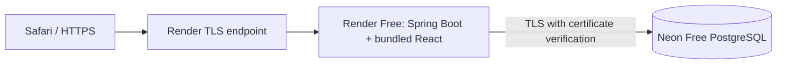

# Live demo and reviewer access

## Open the application

[OperationsFlow live demo](https://operationsflow.onrender.com) is an authenticated
portfolio application. Open it in Safari without installing Docker, Java, Node or
using Terminal. No access to personal files is needed. The owner reports that the
application is live; no provider account or live endpoint was accessed for this
Milestone 10 documentation review.

There is no public shared login or self-service signup. Request an individual,
temporary account privately from the owner. Do not post credentials in GitHub,
review comments, screenshots or recordings. Complete the required initial password
change, sign in again, then explore the dashboard and permitted screens. Sign out
when finished. Only use owner-approved synthetic records for write operations.

## Hosting and security boundary

`Dockerfile.demo` runs one non-root Java process. It serves the built frontend and
same-origin APIs. PostgreSQL is external, so application-container replacement
does not itself delete database records. Render has a public endpoint; free hosting
is not a private network and the login page and limited health endpoints are public.

The repository's demo profile requires HTTPS-edge acknowledgement, Secure cookies,
HttpOnly/SameSite=Strict cookie-only sessions, CSRF protection, BCrypt passwords,
server-enforced roles and audit attribution. Session idle timeout is 30 minutes.
The fixed HTTPS connector deliberately avoids trusting arbitrary forwarded headers.
Database TLS verifies certificates and hostnames. Secrets belong only in provider
managed environment settings, never source control or frontend assets. These are
source-reviewed controls, not a claim that live settings were independently audited.

Sessions and login throttling are process-local. Sleeping/restarting can require
another login and reset limiter buckets; edge IP grouping can affect login limits.
This is one demo instance, not a high-availability or production-certified service.

## Reviewer permissions

The new **DEMO_VIEWER** role is the recommended portfolio role **after a separately
approved deployment of Milestone 11**. This change does not deploy it or create an
account. Until then, the live application's role options may still be the original
three; do not substitute an operator account when read-only access is required.

A viewer can read the dashboard, products/warehouses, stock balances/availability,
and five field-limited reports: orders, inventory, low stock, movements and fulfillment.
The Orders and Fulfillment navigation items use those reports, not sensitive detail
APIs. Customer records/destinations, tracking references, raw ledger reasons/actors,
reservations, audit, user administration, OpenAPI and all CSV exports are denied.
No business mutations are permitted. Personal password change and logout remain
available with CSRF; authentication and password changes still generate audit events.

See [exact permissions and owner account steps](demo-viewer.md). Use a unique synthetic
email-format login alias and privately delivered temporary password for each person.
The reviewer must change the password. Accounts do not expire automatically: the owner
must deactivate them after the review. Revocation takes effect on the next request;
an already executing read may finish. There is no per-reviewer dataset isolation.

Existing roles are unchanged: SALES_OPERATOR can manage customers and create/cancel
orders; WAREHOUSE_OPERATOR can change stock and fulfillment; ADMIN has user management.
Neither operator is a read-only fallback. Keep ADMIN owner-only. Never publish shared
credentials or allow anonymous operational access.

## Verification boundary

The owner reported these successful live manual workflows:

1. Create a product, warehouse and customer.
2. Receive 100 units of stock.
3. Create an order for 20 units; available stock changes from 100 to 80.
4. Cancel the order; reservation release restores available stock to 100.
5. Sign in as administrator after removing temporary bootstrap environment values.

These are manual smoke results, not comprehensive automated E2E coverage. The
[CI evidence](verification.md) covers isolated tests and container smoke checks.
It does not prove which commit is deployed. Full live fulfillment/dispatch, all
roles, exports, concurrent users, quota exhaustion, recovery, sustained traffic
and comprehensive Safari behavior remain unverified. Existing records need not
still match the example quantities; do not present those values as live KPIs.

## Wake-up, health and outages

Render Free can idle after inactivity; Neon can suspend compute separately. Allow
several minutes for the first visit. In constrained CI the app alone needed roughly
114 seconds initially and 109 seconds after restart; platform wake-up and network
latency can add time. These are not live Render measurements or a response-time SLA.
Do not configure artificial keep-alive polling to evade free-tier limits.

- [Demo health](https://operationsflow.onrender.com/actuator/health/demo) reports
  application readiness state without querying the database. `UP` does not prove
  Neon is reachable; this is the intended Render health path.
- [Full readiness](https://operationsflow.onrender.com/actuator/health/readiness)
  includes the database and can wake Neon. Use it for a deliberate diagnostic,
  not frequent external polling. Health responses must not expose internal details.
- If the first visit fails, allow time and retry once. A loading/login screen alone
  does not prove operational database access. If the problem persists, contact the
  owner; do not repeatedly submit orders or receipts after an uncertain response.
  Inspect the existing result before retrying a stock-changing action.
- The owner can check [Render status](https://status.render.com/) and
  [Neon status](https://neonstatus.com/), then inspect provider logs/quotas privately.
  Do not copy environment values, connection strings or session cookies into issues.
  After recovery, sign in again and verify balances/orders before resuming writes.

Free quotas, build allowances, provider policies and account eligibility can change.
Expect limited CPU/memory, cold starts, possible suspension and limited database
recovery retention. Zero cost is conditional on remaining within current free limits;
no automatic paid upgrade is part of this project. Authentication records persist
in Neon along with business data, so backups/exports require private handling even
when every business record is synthetic. Free hosting is suitable for an occasional
scheduled walkthrough, not a guaranteed always-ready recruiter landing experience.

## Owner checklist

Before sharing access, confirm the live source revision, HTTPS/cookie behavior,
needed role workflows and current provider quotas privately. Keep bootstrap values
removed: the existing initialized database must not be bootstrapped again. Never
replace the administrator with a published demo password. Deactivate reviewer accounts
after use. The [controlled deployment proposal](controlled-deployments.md) describes
future approvals and recovery; it enables nothing by itself.
